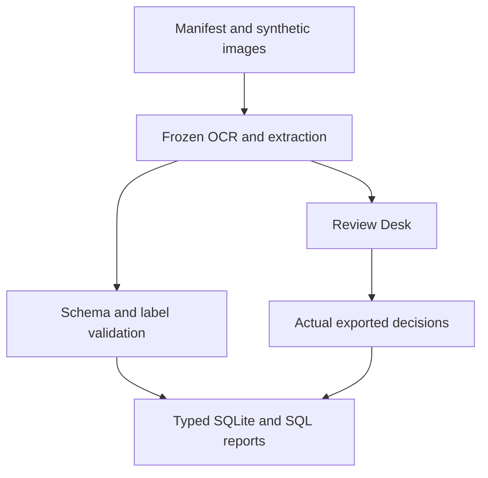

# Insurance Document OCR

[](https://github.com/Quetzel6/insurance-document-orc/actions)

A Python/Tesseract prototype for extracting document IDs, dates and amounts, reviewing uncertain outputs, and querying evaluation evidence in SQLite. All committed evaluation documents are synthetic. This is an independent project with no employer data or production deployment.

**Main finding:** preprocessing improved complete extraction on one cohort but did not generalize to the font/layout challenge. Human review remains required for every document. A complete extraction is not necessarily correct.

## Results at a glance

“Complete” means all three fields exactly match the authored labels. “Wrong fields” counts emitted values that disagree with labels; missing values are counted separately in the analytical tables. Results below are calculated from the linked prediction files and checked against their manifests. Rows reuse some cohorts: do not add their original counts or pool their scores.

| Dataset / experiment | Originals | Method | Complete documents; wrong emitted fields | Limitations |
|---|---:|---|---|---|
| [legacy / dev — initial challenge development](challenge_output/dev_report.json) | 10 | raw / grayscale_threshold | raw: **10/40**; 3 wrong fields<br>grayscale_threshold: **10/40**; 3 wrong fields | Synthetic; inspected development data |
| [legacy / dev — enhanced comparison](enhanced_output/dev_report.json) | 10 | raw / grayscale_threshold / raw_validated / enhanced | raw: **10/40**; 3 wrong fields<br>grayscale_threshold: **10/40**; 3 wrong fields<br>raw_validated: **14/40**; 3 wrong fields<br>enhanced: **30/40**; 0 wrong fields | Synthetic; inspected development data |
| [legacy / test — enhanced comparison](enhanced_output/test_report.json) | 10 | raw / grayscale_threshold / raw_validated / enhanced | raw: **10/40**; 2 wrong fields<br>grayscale_threshold: **10/40**; 4 wrong fields<br>raw_validated: **12/40**; 1 wrong fields<br>enhanced: **30/40**; 1 wrong fields | Synthetic; now inspected; correlated variants |
| [legacy / dev — inspected development variants](experiments/ocr_variants_20261016/report.json) | 10 | current / prepared_sparse / grayscale_block / prepared_otsu | current: **30/40**; 0 wrong fields<br>prepared_sparse: **30/40**; 0 wrong fields<br>grayscale_block: **10/40**; 3 wrong fields<br>prepared_otsu: **30/40**; 0 wrong fields | Synthetic; inspected development data |
| [line / dev — line comparison; pretrained weights only](experiments/line_cohort_20261016/dev_report.json) | 6 | page_current / line_upscale | page_current: **18/24**; 0 wrong fields<br>line_upscale: **17/24**; 0 wrong fields | Synthetic; inspected development data; image bytes not committed |
| [line / test — line comparison; pretrained weights only](experiments/line_cohort_20261016/test_report.json) | 6 | page_current / line_upscale | page_current: **18/24**; 0 wrong fields<br>line_upscale: **18/24**; 0 wrong fields | Synthetic; now inspected; correlated variants; image bytes not committed |
| [model / dev — model comparison; pretrained weights only](experiments/model_cohort_20261016/dev_report.json) | 6 | installed / tessdata_best | installed: **16/24**; 0 wrong fields<br>tessdata_best: **18/24**; 0 wrong fields | Synthetic; inspected development data; image bytes not committed |
| [model / test — model comparison; pretrained weights only](experiments/model_cohort_20261016/test_report.json) | 6 | installed / tessdata_best | installed: **18/24**; 0 wrong fields<br>tessdata_best: **18/24**; 0 wrong fields | Synthetic; now inspected; correlated variants; image bytes not committed |
| [priority / dev — development Linux; frozen dev-selected policy](supplements/review_priority/measured_linux/dev_predictions.json) | 6 | raw / upscale_sharpen | raw: **14/18**; 1 wrong fields<br>upscale_sharpen: **14/18**; 0 wrong fields | Synthetic; inspected development data |
| [priority / test — development Linux; frozen dev-selected policy](supplements/review_priority/measured_linux/test_predictions.json) | 6 | raw / upscale_sharpen | raw: **11/18**; 0 wrong fields<br>upscale_sharpen: **13/18**; 0 wrong fields | Synthetic; now inspected; correlated variants |
| [font_challenge / challenge — development Linux; frozen font/layout challenge](supplements/review_priority/measured_font_challenge/predictions.json) | 12 | raw / upscale_sharpen | raw: **22/36**; 7 wrong fields<br>upscale_sharpen: **18/36**; 6 wrong fields | Synthetic; now inspected; correlated variants; frozen policy underperforms raw; six wrong dates |

The legacy enhanced test recovered 30/40 documents versus raw 10/40, but still emitted one wrong field. The review-priority test recovered 13/18 versus 11/18. On the new font/layout challenge, the same frozen policy recovered **18/36 versus raw 22/36**, emitting **six wrong dates**. Its prioritized subset contained 18 images and no observed complete-but-wrong output; coverage was only 50%. Threshold 0 does not establish a benefit from confidence filtering. Zero observed errors in a small subset is not a zero-risk guarantee.

## Run from a fresh checkout

Requires Git and Docker. Run in a new directory:

```bash
git clone https://github.com/Quetzel6/insurance-document-orc.git
cd insurance-document-orc
docker build -t insurance-document-orc:pilot .
docker run --rm -v "$PWD:/work" insurance-document-orc:pilot make test
docker run --rm -v "$PWD:/work" insurance-document-orc:pilot make verify-frozen
docker run --rm -v "$PWD:/work" insurance-document-orc:pilot make pipeline
```

The pipeline performs actual OCR and extraction on all 36 font-challenge images using both methods, validates those outputs plus the archived reports, loads typed SQLite tables, checks exact replay and generates six SQL reports. It makes no API calls. It does not rerun every historical OCR experiment. Output is a new directory under `output/analytics/`, containing `analytics.sqlite3`, six CSV tables, `query_results.json`, `report.html` and `pipeline_status.json`.

For reporting from recorded evidence only, replace `make pipeline` with `make analytics`. Neither command overwrites earlier runs. Local Python 3.10+ with the pinned requirements and Tesseract can run the same make targets. [Schema, SQL questions and data-quality contract](docs/guides/ANALYTICS.md).

## Review Desk and Image Reader

To open the existing benchmark Review Desk locally (Python 3.10+):

```bash
python3 -m venv .venv
source .venv/bin/activate
python -m pip install -r requirements.txt
python review_app.py
```

Open http://127.0.0.1:8765. Compare source images and extracted fields, correct values, approve/reject and export decisions. Review state persists under `review_state/`. Reset archives the prior round. No human decisions are invented by the analytical pipeline; its review tables remain empty until an actual benchmark export is supplied with `--review-export`.

For uploaded images, [Image Reader](docs/guides/IMAGE_READER_GUIDE.md) supports English or Thai+English recognition, and [uploaded-image review](docs/guides/UPLOAD_REVIEW_GUIDE.md) uses a separate queue. Thai language availability is not an accuracy evaluation. Uploaded images, private review databases and exports must remain outside Git.



## Reproduction and provenance

- Recorded initial results were produced in a Linux development environment. Reports retain their original hashes and environment metadata.
- The project owner reproduced the selected review-priority result (13/18) and font-challenge result (18/36, six wrong fields) using Docker on Mac, and supplied terminal output for 19 supplement tests. [Verification record](supplements/review_priority/AUTHOR_VERIFICATION.md).
- Full `mac_font_challenge_01/` files have not yet been supplied to this checkout. The Mac statement is terminal-reported evidence, not a committed second raw prediction set.
- GitHub Actions workflows run tests and fresh OCR reproduction. Use the badge/run details for the exact revision and result; workflow presence alone is not evidence of a passing run.
- Line/model archived reports and manifests are available, but 96 corresponding image files are absent. The analytical layer flags `image_bytes_verified=0` for these images. It verifies their report/label consistency, not absent image bytes.

## Code and documentation

| Location | Purpose |
|---|---|
| `review_app.py`, `review_store.py`, browser assets | Review application and persistent review state |
| `image_reader.py` | Uploaded-image OCR |
| `project.py`, `challenge.py`, `enhanced.py` | Original benchmark and frozen comparisons |
| `*_experiment.py`, `extraction_candidate.py` | Historical experimental drivers |
| `supplements/review_priority/` | Frozen policy and font/layout challenge |
| `ocr_analytics/`, `sql/analytics/` | Validated analytical loading and six SQL questions |
| `docs/guides/` | Current workflow documentation |
| `docs/history/` | Historical change notes, not current setup instructions |
| `docs/evidence/frozen_files.json` | Hash inventory for frozen source, datasets and evidence |

Frozen experiment code is **frozen for reproducibility; style intentionally unchanged**. File names and locations remain stable because reports reference their hashes. Ruff checks the new analytical code and support scripts; it excludes frozen drivers. `make verify-frozen` verifies the inventory and original benchmark fingerprints. Do not reformat frozen files to satisfy a linter.

## What I learned and next steps

The font challenge changed the conclusion: a preprocessing choice that helped one cohort can damage date extraction on another. I therefore report missing values, wrong emitted values and complete-but-wrong documents separately. Review edits are observations, not verified ground truth or measured time savings.

Next work is independently labeled document samples, more font/layout coverage, and measured review effort. These experiments do not establish real insurance-document accuracy, Thai accuracy, generalization to scanned handwriting or a production business benefit. No custom model was trained. PDF ingestion and table reconstruction remain outside scope.
